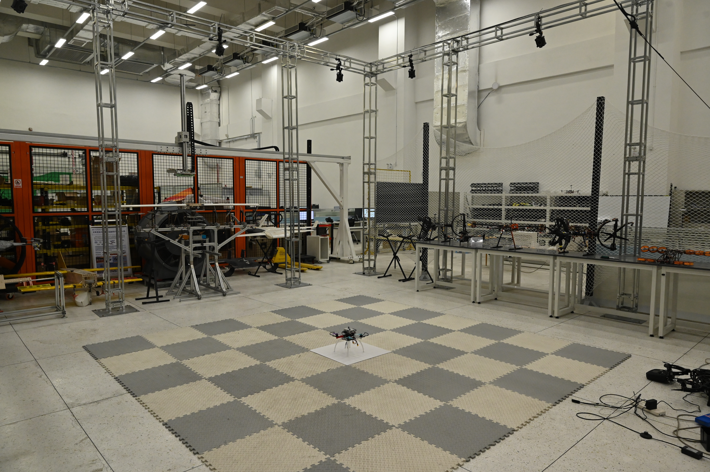
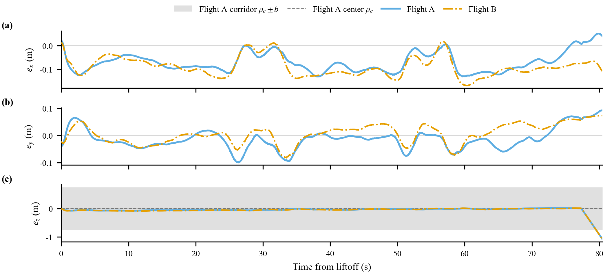
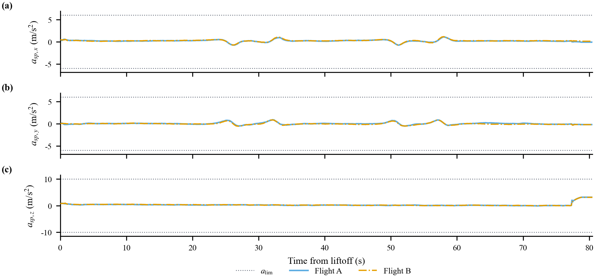
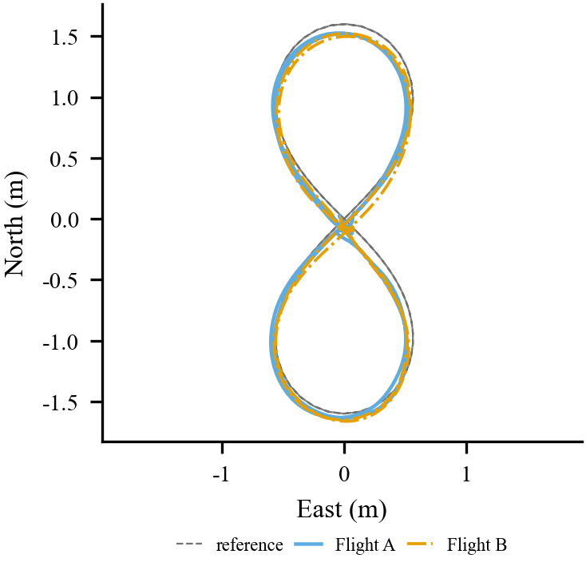

# Cycloid-Inspired Prescribed Performance Sliding-Mode Position Control of Quadrotors With Bounded Time-Varying Gains



*Indoor flight area. The two flight logs were recorded with the quadrotor in this room.*

Short name: **BIPPSMC**.

This repository holds the PX4 v1.15.4 position-controller sources, two real-flight logs, and the figures drawn from those logs. The curves use the same panel layout as the paper: per-axis position error, commanded acceleration, and the horizontal path. Simulator runs are a separate code check and are not drawn on these figures.

## Flights

| Flight | Log | SHA256 |
|---|---|---|
| A | [data/log_19_2026-10-19-10-01-54.ulg](data/log_19_2026-10-19-10-01-54.ulg) | `34d4087e9f9f53c8364c87fd2501edbf2f88131b98b14af4910c027afb3eea7e` |
| B | [data/log_2.ulg](data/log_2.ulg) | `d96751a3576ee280d0c288d8a53f4f393f5006c9c6b5c32192b82d8dcbfde632` |

Both logs record the onboard figure-eight task with `MPC_CTRL_METHOD=1`. The bytes are unchanged. Numeric metrics already computed for Flight A are in [data/REPORT.md](data/REPORT.md).

## Figures

Time is seconds from liftoff. Each trace runs through touchdown, including takeoff, hover, the figure-eight, the return, and the descent. Position error is the estimator position minus the reference. The vertical panel shows Flight A's logged corridor \(\rho_c\pm b\); the planar panels omit it so the half-width does not hide the traces. Short ticks, if present, are corridor-center resets. Dotted lines on the acceleration figure are the logged command limits. The horizontal path uses the same liftoff-to-touchdown interval. Each flight is shifted so its reference at liftoff is the origin.



*Per-axis position error. \(e_x\), \(e_y\), and \(e_z\) are north, east, and down.*



*Position-loop acceleration commands \(a_{sp,x}\), \(a_{sp,y}\), and \(a_{sp,z}\).*



*Horizontal path from liftoff to touchdown. The dashed curve is the reference. Solid is Flight A and dash-dot is Flight B.*

## Source, data, and documents

| Item | Path |
|---|---|
| Firmware overlay and baseline | [firmware/](firmware/) |
| Flight A log | [data/log_19_2026-10-19-10-01-54.ulg](data/log_19_2026-10-19-10-01-54.ulg) |
| Flight B log | [data/log_2.ulg](data/log_2.ulg) |
| Flight A parameters | [params/flight_profile.params](params/flight_profile.params) |
| Flight A metrics | [data/REPORT.md](data/REPORT.md) |
| Figures | [figs/](figs/) |
| Offline recompute | `scripts/analyze_sample.py --verify` |
| Aircraft setup | [docs/REAL_AIRCRAFT.md](docs/REAL_AIRCRAFT.md) |

The logged parameter names `BPP_*` and the topic `bppsmc_debug` are the names stored in the ULogs. They are kept so the offline check still matches the records.

## What to run

| Goal | Entry | Requirements |
|---|---|---|
| View the flights | Figures above and [data/REPORT.md](data/REPORT.md) | None |
| Recompute Flight A metrics | `scripts/analyze_sample.py --verify` | Python 3.10 and the locked requirements |
| Offline trajectory tests | `scripts/test_offline.py` | The same Python environment and g++ |
| Build the aircraft firmware | `scripts/reproduce.py build real` | Ubuntu 22.04, the ARM compiler, and the pinned PX4 sources |
| Run a local simulator task | `scripts/run_sitl.py --execute-sitl` | A built SITL tree and Gazebo Harmonic |
| Configure an aircraft | [docs/REAL_AIRCRAFT.md](docs/REAL_AIRCRAFT.md) | Matching propulsion, sensing, external pose, and a manual override |

The package contains the overlay, the pinned baseline, the fetch and build entry points, and a rebuilt aircraft firmware image. It is not an offline system image: the first installation of system packages and the PX4 tree needs a network. Restoring the sources does not use the author's directories, old build caches, or an existing ROS workspace.

## 1. Offline check

Run these commands from the repository root on a Linux filesystem. Paths must not contain spaces.

```bash
python3 scripts/verify_package.py

python3 -m venv workspace/venv
source workspace/venv/bin/activate
python -m pip install -r environments/requirements.lock.txt

python scripts/test_offline.py
python scripts/analyze_sample.py --verify
```

Recomputed metrics are written to `reports/log_19/` and do not overwrite `data/`. The tolerance is relative 1e-6 and absolute 1e-8; see [data/expected_metrics.json](data/expected_metrics.json). Images are not required to match pixel for pixel.

On Flight A the figure-eight task finishes two laps, lands, and disarms. Its three-dimensional position RMSE is about **0.1026 m** and the horizontal RMSE is about **0.0959 m**. These are estimator-to-reference errors for that one log, not an independent position truth and not a multi-flight statistical claim.

## 2. Fetch the sources and build

The recorded environment is Ubuntu 22.04 amd64, Python 3.10, ARM GCC 10.3.1, and Gazebo Harmonic 8.15.0. See [environments/versions.json](environments/versions.json).

The setup script uses sudo/apt. It does not flash hardware and it does not start a simulation:

```bash
bash scripts/setup_ubuntu22.sh --gazebo
source workspace/venv/bin/activate

python scripts/reproduce.py prepare
python scripts/reproduce.py build all --jobs 2
python scripts/reproduce.py check --binary real
python scripts/reproduce.py check --binary sitl
```

Omit `--gazebo` and run `build real` when only the aircraft firmware is needed. `prepare` fetches the pinned PX4 baseline and the listed 32 dependency repositories, then checks and applies the 28-file overlay. It writes only this package's `workspace/` and refuses to overwrite a conflicting file.

The PX4 baseline is `99c40407ffd7ac184e2d7b4b293f36f10fe561ef` (v1.15.4). Commits, dependency URLs, and file hashes are in [firmware/BASELINE.json](firmware/BASELINE.json). Full modified files are in `firmware/overlay/`; review diffs are in `firmware/*.patch`.

`prepare --mirror-source /path/to/PX4-Autopilot` can reuse a local Git mirror of the same baseline. That option is not required. A mirror checkout is not a portable source copy.

The aircraft target is `px4_fmu-v6c_onboard`. Its output is `workspace/artifacts/px4_fmu-v6c_onboard/`.

## 3. Local simulator task

```bash
python scripts/run_sitl.py --execute-sitl
```

This starts the package's local PX4/Gazebo process, drives a simulated RC switch, arms the simulated vehicle, runs one onboard task, and waits for landing and disarm. The host does not publish the trajectory; `figure8_trajectory` does. Without `--execute-sitl` the script refuses to start. If a PX4 process or UDP port 18570 is already in use, it exits and does not kill that process.

Results go to `workspace/results/sitl_<time>/`. A timeout is not reported as a completed task. `--controller pid` checks the native branch; it is not another packaged flight sample. The simulator uses its own vehicle and its own hover mapping, recorded in `validation/sitl_result.json`. That mapping is not an aircraft parameter and is not imported into `flight_profile`. The simulator check is an engineering gate for this package. It is not a result of the paper's software-in-the-loop comparison.

```bash
python scripts/check_sitl_result.py workspace/results/sitl_<time>
```

## 4. Parameters and firmware

- [params/flight_profile.params](params/flight_profile.params): 36 algorithm and task parameters taken from Flight A, including `MPC_THR_HOVER=0.21` and `MPC_CTRL_METHOD=1`.
- [params/all_parameters.json](params/all_parameters.json): all 1153 initial parameters from that log.
- `params/all_parameters_REFERENCE_ONLY.params`: a full QGroundControl text, including airframe and sensor calibration. Do not import it onto another vehicle.
- [docs/PARAMETERS.md](docs/PARAMETERS.md): defaults, sample values, coordinates, and when each parameter takes effect.

Sample values are not written into every firmware default. A fresh build leaves `MPC_CTRL_METHOD=0` and `F8_ENABLE=0`. Select the position controller and enable the task on the vehicle, then read the parameters back.

The files in `artifacts/` were rebuilt from this frozen tree. They are not proven byte-identical to the binary that flew Flight A. This package was not produced by flashing or flying again.

## 5. Further documents

- [docs/ALGORITHM.md](docs/ALGORITHM.md)
- [docs/REAL_AIRCRAFT.md](docs/REAL_AIRCRAFT.md)
- [data/REPORT.md](data/REPORT.md)
- [VALIDATION.md](VALIDATION.md)
- [CHANGELOG.md](CHANGELOG.md)
- [THIRD_PARTY_NOTICES.md](THIRD_PARTY_NOTICES.md)

The onboard task does not need ROS or DDS. An external pose source may still need its own bridge. Motor, propeller, ESC, battery, payload, and pose-sensor models are not in the logs and are listed as unknown in the aircraft note.

Hardware-in-the-loop, the paper's multi-controller software-in-the-loop batch, and other flight logs are outside this package's reproduction claim. One completed flight does not establish the controller for every vehicle and every condition.
